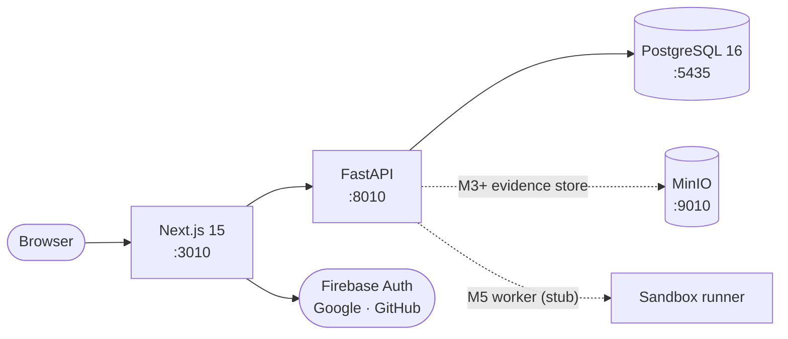

<div align="center">


# Meridian AI

[](https://github.com/VivekChaurasiya95/Meridian-AI/actions)
[](LICENSE)
[](apps/web/package.json)
[](services/api/pyproject.toml)
[](https://github.com/VivekChaurasiya95/Meridian-AI/pulls)


**An AI-assisted debugging and reliability platform.** Meridian turns a developer's
bug report into a structured, evidence-backed investigation — reproduce, capture
evidence, hypothesize, test, patch, verify, report — with a human approving every step.

[Quickstart](#-getting-started) · [API Reference](#-api-reference) · [Roadmap](#-roadmap) · [Author](#-author)

</div>

---

## 📑 Contents

- [✨ Features](#-features)
- [🎬 Product Tour](#-product-tour)
- [🏗️ Architecture](#-architecture)
- [🧰 Tech Stack](#-tech-stack)
- [🚀 Getting Started](#-getting-started)
- [🔐 Social Sign-In Setup](#-social-sign-in-setup-optional)
- [🗂️ Project Structure](#-project-structure)
- [🔌 API Reference](#-api-reference)
- [⚙️ Configuration](#-configuration)
- [✅ Testing & Quality Gates](#-testing--quality-gates)
- [🗺️ Roadmap](#-roadmap)
- [📄 License](#-license)
- [👨‍💻 Author](#-author)

> **Milestone 2 status (this checkout):** app shell with brand system, session
> authentication (email/password plus Google/GitHub via Firebase), and workspace
> management with membership roles — all backed by PostgreSQL. Project onboarding
> and the investigation pipeline (execution, browser reproduction, AI reasoning,
> patches, verification) arrive in later milestones. The UI never presents unbuilt
> stages as real.

Spec authority: `SECURITY.md` > PRD > `ARCHITECTURE.md`/`API.md` > `DATABASE.md` >
`DESIGN_SYSTEM.md` > `IMPLEMENTATION_PLAN.md`. Conflicts and resolutions live in
[docs/DECISIONS.md](docs/DECISIONS.md).

## ✨ Features

| Area | What works today |
|---|---|
| 🖥️ **App shell** | Brand system, warm light/dark themes, landing page with motion design |
| 🔑 **Session auth** | Email/password signup, login, logout, `/me` profile — opaque server-side sessions |
| 🌐 **Social login** | Google and GitHub sign-in via Firebase, exchanged for the same session cookie |
| 🏢 **Workspaces** | Create/rename workspaces, cursor pagination, role-based membership (owner/admin/developer/viewer) |
| 🎥 **Product tour** | Animated explainer of the investigation loop, or attach your own demo video |
| 🔬 **Playground** | Interactive desktop scene: feed a file, pick a workflow, watch the agents work |
| 👨‍💻 **Developer page** | Meet-the-developer story, stack, and project highlights |
| ❤️ **Health checks** | Liveness (no DB) and readiness (DB + dependency checks) endpoints |

## 🎬 Product Tour

The landing page ships a **13-second motion explainer** — report → reproduce →
evidence → patch → verify — with play/pause, replay, and per-scene progress.
Prefer your own footage? Set one variable and the section swaps in your video:

```powershell
# apps/web/.env.local — YouTube link or direct .mp4 URL
NEXT_PUBLIC_DEMO_VIDEO_URL=https://www.youtube.com/watch?v=YOUR_VIDEO_ID
```

Restart the web server after changing it.

## 🏗️ Architecture



| Service | Tech | Port | Purpose |
|---|---|---|---|
| `web` | Next.js (App Router, TypeScript, Tailwind v4) | 3010 | Landing, auth pages, workspace UI |
| `api` | FastAPI + SQLAlchemy + Alembic | 8010 | REST API, sessions, workspaces |
| `db` | PostgreSQL 16 | 5435 | Users, sessions, workspaces, members |
| `minio` | MinIO (S3-compatible) | 9010 / 9011 | Evidence object storage (M3+) |
| `worker` | Python stub | — | Isolated execution sandbox (M5) |

## 🧰 Tech Stack

<p>
  
  
  
  
  
  
  
  
  
  
</p>

## 🚀 Getting Started

**Prerequisites:** Node.js ≥ 20.9 and npm · Python ≥ 3.12 and pip · Docker (for PostgreSQL), or a local PostgreSQL 16.

Run each block in its own terminal, all from the repo root (`cd D:\Projects\Meridian-AI`
— or wherever you cloned it).

**One-time setup** (any terminal):

```powershell
Copy-Item .env.example .env
python -m venv .venv
.\.venv\Scripts\Activate.ps1
pip install -e "services/api[dev]"
docker compose up -d db
# first time only: database for the test suite
docker exec meridian-db-1 psql -U meridian -d meridian -c "CREATE DATABASE meridian_test;"
alembic upgrade head
cd apps/web
npm install
cd ../..
```

**Terminal 1 — Database** (leave running):

```powershell
docker compose up db
```

**Terminal 2 — Backend API** (leave running):

```powershell
.\.venv\Scripts\Activate.ps1
uvicorn app.main:app --app-dir services/api --host 127.0.0.1 --port 8010
# -> http://127.0.0.1:8010/health/live
```

**Terminal 3 — Frontend** (leave running):

```powershell
cd apps/web
npm run dev
# -> http://localhost:3010            landing
# -> http://localhost:3010/app        workspace home (live API data)
# -> http://localhost:3010/developer  developer story
```

Start order matters: database first, then API, then web. Stop everything with
`Ctrl+C` in each terminal. Alternative: `docker compose up --build` runs
Postgres + API together (web still runs locally).

## 🔐 Social Sign-In Setup (optional)

Password auth works with zero setup. To enable the Google/GitHub buttons:

1. In the [Firebase console](https://console.firebase.google.com), create a project
   (or reuse one), then **Authentication → Sign-in method**: enable **Google** and
   **GitHub**. For GitHub, create a GitHub OAuth App (GitHub Settings → Developer
   settings) with authorization callback URL
   `https://<your-project-id>.firebaseapp.com/__/auth/handler`, and paste its
   client ID/secret into Firebase.
2. **Authentication → Settings → Authorized domains**: add `localhost`.
3. **Project settings → Your apps → Web**: register a web app and copy its config.
4. Put the web config in `apps/web/.env.local` (`NEXT_PUBLIC_FIREBASE_*`, see
   `.env.example`) and set `FIREBASE_PROJECT_ID` in the repo-root `.env`. Restart
   both servers. The API needs only the project ID — tokens verify against Google's
   public certs, so no service-account key is stored anywhere.

## 🗂️ Project Structure

```text
apps/web/               Next.js frontend (App Router, TypeScript, Tailwind v4)
├── app/                Routes: landing (/), login, signup, /app, /developer
├── components/         auth · brand · landing · shell · ui · workspaces
├── e2e/                Playwright specs (run by CI, no backend required)
└── public/             Brand art + developer portrait
services/api/           FastAPI backend (app/*) with co-located tests
services/worker/        (M5) isolated execution worker — stub for now
services/orchestrator/  (M4+) investigation state machine — not yet built
migrations/             Alembic migrations (PostgreSQL, versioned)
docs/DECISIONS.md       Working architecture decision log
public/                 Product specifications (source of truth; never edited)
```

## 🔌 API Reference

All `/api/v1` responses use the `{data, request_id}` / `{error, request_id}` envelope.
Sessions travel in the `meridian_session` HttpOnly cookie (`SameSite=Lax`) or as
`Bearer` tokens (see `docs/DECISIONS.md` D17–D20).

<details>
<summary><strong>Endpoints (M2)</strong></summary>

| Method & path | Purpose | Auth |
|---|---|---|
| `GET /health/live` | `{"status":"ok"}` — no DB touch | — |
| `GET /health/ready` | `{"status":"ready","checks":{…}}` or `503` | — |
| `POST /api/v1/auth/signup` | `{email, password, display_name}` → `201` + session cookie | — |
| `POST /api/v1/auth/login` | `{email, password}` → `200` + session cookie | — |
| `POST /api/v1/auth/firebase` | `{id_token}` (Google/GitHub) → `200` + session cookie; `503` if unconfigured | — |
| `POST /api/v1/auth/logout` | `204`, revokes session, clears cookies | Session |
| `GET /api/v1/me` | Current profile | Session |
| `PATCH /api/v1/me` | `{display_name}` — allowlisted field only | Session |
| `POST /api/v1/workspaces` | `{name, slug}` → `201` | Session |
| `GET /api/v1/workspaces?limit&cursor` | Paginated workspace list | Session |
| `GET /api/v1/workspaces/{id}` | Workspace + caller's role | Member |
| `PATCH /api/v1/workspaces/{id}` | `{name}` | Owner/admin |
| `GET /api/v1/workspaces/{id}/members` | Member list | Member |
| `POST /api/v1/workspaces/{id}/members` | Add existing user `{email, role}` | Owner/admin |
| `PATCH /api/v1/workspaces/{id}/members/{user_id}` | Change role (never demote last owner) | Owner/admin |
| `DELETE /api/v1/workspaces/{id}/members/{user_id}` | Remove member (never the last owner) | Owner/admin |

</details>

## ⚙️ Configuration

Copy `.env.example` → `.env` (root, for the API) and set `apps/web/.env.local` (for
the browser — Next.js does not read the root file). Never commit either.

<details>
<summary><strong>Environment variables</strong></summary>

| Variable | Where | Default | Purpose |
|---|---|---|---|
| `DATABASE_URL` | root `.env` | `…@localhost:5435/meridian` | API database |
| `TEST_DATABASE_URL` | root `.env` | `…_test` | Pytest database |
| `CORS_ALLOW_ORIGINS` | root `.env` | loopback × ports | Allowed browser origins |
| `SECURE_COOKIES` | root `.env` | `false` | `true` in production (HTTPS) |
| `FIREBASE_PROJECT_ID` | root `.env` | empty (disabled) | Enables `/auth/firebase` |
| `NEXT_PUBLIC_API_URL` | `apps/web/.env.local` | `http://localhost:8010` | API base for the browser |
| `NEXT_PUBLIC_FIREBASE_*` | `apps/web/.env.local` | empty (disabled) | Firebase web config (4 keys) |
| `NEXT_PUBLIC_DEMO_VIDEO_URL` | `apps/web/.env.local` | empty (placeholder) | Landing demo video |
| `S3_*` | root `.env` | MinIO defaults | Evidence storage (M3+) |

</details>

## ✅ Testing & Quality Gates

Every push runs three CI jobs ([workflow](.github/workflows/ci.yml)): `api`
(lint, typecheck, migrate, pytest), `web` (lint, typecheck, build), and `e2e`
(Playwright, Chromium — no backend required). Run the same gates locally:

```powershell
# Backend (from services/api)
ruff check . ; ruff format --check .
mypy app
pytest                                   # needs TEST_DATABASE_URL up

# Frontend (from apps/web)
npm run lint
npm run typecheck
npm run build
npx playwright install --with-deps chromium   # first time only
npm run e2e
```

Current coverage: **76 backend tests** (auth, sessions, Firebase exchange, members,
workspaces, request IDs) and **9 e2e specs** (landing, auth forms, password toggles,
theme, API-base units).

## 🗺️ Roadmap

- [x] **M1** — App shell, brand system, landing page
- [x] **M2** — Session auth (password + Firebase social), workspaces, membership roles
- [ ] **M3** — Project onboarding, MinIO evidence storage
- [ ] **M4** — Investigation state machine (orchestrator)
- [ ] **M5** — Isolated execution worker (sandbox)
- [ ] **M6–M10** — Browser reproduction, AI reasoning, patches, verification, reporting

## 📄 License

MIT — see [LICENSE](LICENSE).

## 👨‍💻 Author

<div align="center">

**Vivek Chaurasiya** — Full-stack developer · Creator of Meridian AI

[](https://github.com/VivekChaurasiya95)
[](https://www.linkedin.com/in/vivek-chaurasiya-722037315)
[](https://vivek-chaurasiya.vercel.app)

*Designed & built end to end — interface, API, data model, and infrastructure.*

</div>
