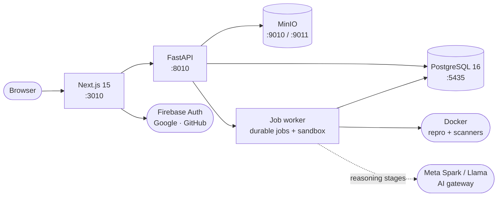

<div align="center">


# Meridian AI

[](#-built-with-meta)
[](https://github.com/VivekChaurasiya95/Meridian-AI/actions)
[](LICENSE)
[](public/IMPLEMENTATION_PLAN.md)
[](apps/web/package.json)
[](services/api/pyproject.toml)


**An AI-assisted debugging and reliability platform.** Meridian turns a bug
report into a structured, evidence-backed investigation — reproduce, capture
evidence, hypothesize, test, patch, verify, report — with a human approving
every consequential step.

[🎬 Demo](#demo) · [🚀 Quickstart](#quickstart) ·
[📖 Detailed Documentation](Detailed%20Documentation.md) ·
[🏗️ Architecture](#architecture) · [👥 Team](#team)

</div>

---

## 🎬 Demo

| | |
|---|---|
| **Demo video** | Coming soon — the landing page swaps in your footage via one env var (`NEXT_PUBLIC_DEMO_VIDEO_URL`, see [Detailed Documentation](Detailed%20Documentation.md)). Until then it ships a 13-second animated explainer of the investigation loop. |
| **Live walkthrough** | Follow [Quickstart](#-quickstart), then run the scripted 12-step checklist in [docs/DEMO.md](docs/DEMO.md) (seeds a fixable and a blocked investigation, with reset). |
| **Interactive API docs** | `http://127.0.0.1:8010/docs` while the API runs (FastAPI/Swagger). |

## ❓ Problem & Solution

Debugging production issues usually means scattered logs, unreproducible bugs,
and fixes nobody can explain. Meridian structures that work into a repeatable,
auditable pipeline:

1. **Onboard** — upload a repository ZIP (or import from GitHub); Meridian validates, inspects, and snapshots it immutably.
2. **Reproduce** — capture the failure in an isolated sandbox with recorded evidence.
3. **Hypothesize** — generate evidence-grounded hypotheses (model-assisted, human-approved).
4. **Test & patch** — add regression tests, propose unified-diff patches behind scoped human approval.
5. **Verify & report** — run baseline/post-patch verification and produce a deterministic investigation report.

Every stage is persisted, auditable, and gated by human approval where it
matters. The UI never presents unbuilt stages as real — anything not yet
implemented is explicitly marked or absent.

## ✨ Built with Meta

Meridian's reasoning layer is designed around Meta models, plugged in through
one centralized AI gateway (`services/api/app/ai/` + `app/services/model_gateway.py`)
with task-based routing, token budgets, secret redaction, and metadata-only
telemetry:

- **Meta Spark (text/reasoning)** — first-choice provider, set via `META_SPARK_BASE_URL` / `META_SPARK_API_KEY` / `META_SPARK_MODEL`. Handles every text task below through the same OpenAI-compatible chat-completions transport (retries, timeouts, token accounting in one place).
- **Meta Llama (OpenAI-compatible)** — fallback when Spark is off, set via `META_BASE_URL` / `META_API_KEY` / `META_MODEL_DEFAULT` / `META_MODEL_REASONING` / `META_MODEL_FAST` / `META_MODEL_REPORT`. Resolution order is Spark → Llama → existing provider; critical tasks never silently downgrade to a weaker tier.
- **Meta SAM (image segmentation)** — worker-only evidence-screenshot path, set via `META_SAM_*`. Fail-closed: validates the request and blocks honestly until the endpoint is operator-verified.

| Task | Tier | Used for |
|---|---|---|
| Investigation planning, complex reasoning, root-cause analysis *(critical — no downgrade)* | reasoning | Planning the debug strategy, deep causal analysis |
| Security interpretation, remediation suggestion, report generation | reasoning | Explaining scanner findings, proposing fixes, writing the final report |
| Repository analysis, investigation chat | fast | Codebase orientation, Q&A over the investigation |
| Document summarization, structured extraction | fast | Summaries, pulling structured fields from evidence |
| Vision segmentation, image understanding | fast | SAM evidence-image analysis (worker-only) |

Every call is schema-validated, secret-redacted, and token-budgeted
(`META_REQUEST_TIMEOUT`, `META_MAX_RETRIES`, per-task input/output caps).
With no keys configured, each provider raises `MODEL_PROVIDER_UNAVAILABLE`
and reasoning stages block honestly instead of fabricating output.

Honest-by-design: deterministic scanners (Semgrep/Gitleaks) remain the source of
findings — models never invent scan results — and everything ships
disabled-by-default, so the app runs fully without keys. Full plan, routing
policy, and safeguards: [META_INTEGRATION_PLAN.md](META_INTEGRATION_PLAN.md);
enablement: [Detailed Documentation](Detailed%20Documentation.md#93-model-providers--meta-spark--llama--sam).

## ✅ Key features

| Area | What works today |
|---|---|
| 🔬 **Investigations** | Staged debugging pipeline: reproduce → evidence → hypotheses → tests → patch → verify, all persisted and auditable |
| 🧪 **Hypotheses & verification** | Evidence-grounded hypotheses with human reviews; regression tests; baseline-vs-post-patch verification runs with reruns |
| 🩹 **Patches** | Unified-diff proposals bound to exact digest + snapshot, approved by humans, applied only after approval |
| 📝 **Reports** | Deterministic md/html investigation reports rendered from persisted rows (no invented IDs), short-lived audited downloads |
| 🛡️ **Security preflight** | Every snapshot scanned by Semgrep + Gitleaks in isolated containers; findings API + read-only UI |
| 📦 **Projects** | ZIP upload with archive validation, stack inspection, immutable snapshots, repo browser, GitHub import |
| 🏢 **Workspaces** | Create/rename, cursor pagination, role-based membership (owner/admin/developer/viewer), audit trail |
| 🔑 **Auth** | Email/password + Google/GitHub via Firebase, exchanged for opaque server-side sessions (HttpOnly cookies) |
| 🤖 **Meta AI gateway** | Spark-first text routing, Llama fallback, SAM image path — central budgets, redaction, honest-unconfigured states |
| 🎨 **Product polish** | Warm light/dark themes, toasts, visibility-aware polling, empty/loading/error states, responsive + a11y pass |

## 🚀 Quickstart

**Prerequisites:** Node.js ≥ 20.9, Python ≥ 3.12, Docker Desktop (Linux
containers), Git. Ports `3010`, `8010`, `5435`, `9010`, `9011` must be free.

```powershell
# 1. Clone + environment
git clone https://github.com/VivekChaurasiya95/Meridian-AI.git
cd Meridian-AI
Copy-Item .env.example .env

# 2. Python env + API (editable install)
python -m venv .venv
.\.venv\Scripts\Activate.ps1
pip install -e "services/api[dev]"

# 3. Infrastructure (Postgres + MinIO)
docker compose up -d db minio minio-init

# 4. Test DB (first time) + migrations
docker exec meridian-db-1 psql -U meridian -d meridian -c "CREATE DATABASE meridian_test;"
alembic upgrade head

# 5. Frontend
cd apps/web; npm install; cd ../..
```

Then one terminal per process (start order matters: infra → API → worker → web):

```powershell
docker compose up db minio                                                     # 1. infra
.\.venv\Scripts\Activate.ps1; uvicorn app.main:app --app-dir services/api --host 127.0.0.1 --port 8010   # 2. API :8010
.\.venv\Scripts\Activate.ps1; python services/worker/main.py                   # 3. worker
cd apps/web; npm run dev                                                       # 4. web :3010
```

Open `http://localhost:3010`, sign up, create a workspace + project, upload a
ZIP, and watch ingestion → snapshot → security preflight run end to end. Full
setup, run modes, endpoints, and troubleshooting:
[Detailed Documentation](Detailed%20Documentation.md).

| Service | URL |
|---|---|
| Web app | `http://localhost:3010` |
| Workspace home | `http://localhost:3010/app` |
| API liveness / readiness / docs | `http://127.0.0.1:8010/health/live` · `/health/ready` · `/docs` |
| MinIO console / S3 | `http://localhost:9011` · `http://localhost:9010` |

## 🏗️ Architecture



**Request lifecycle:** browser → Next.js → FastAPI (session cookie) → Postgres
for state, MinIO for snapshot/evidence bytes. Long-running work (reproduction,
scans, model reasoning) runs as durable worker jobs with leases, so API
restarts never lose or double-run a job. Untrusted repository code only ever
executes inside locked-down sandbox containers (no network, non-root, read-only
root filesystem) — never in the API process.

| Service | Tech | Port | Purpose |
|---|---|---|---|
| `web` | Next.js 15 App Router, TypeScript, Tailwind v4 | 3010 | Landing, auth, workspace UI |
| `api` | FastAPI + SQLAlchemy + Alembic | 8010 | REST API, sessions, investigations |
| `db` | PostgreSQL 16 | 5435 | Users, sessions, projects, jobs, investigations |
| `minio` | MinIO (S3-compatible) | 9010 / 9011 | Snapshot + evidence bytes, console |
| `worker` | Python job worker | — | Durable jobs, investigation pipeline, sandbox scans |
| `meta` | Meta models via AI gateway (external, optional) | — | Reasoning stages + reports |

## 🧰 Tech stack

<p>
  
  
  
  
  
  
  
  
</p>

Full version table: [Detailed Documentation](Detailed%20Documentation.md#6-tech-stack-reference).

## 🗂️ Repository layout

```text
apps/web/                 Next.js frontend (App Router, TypeScript, Tailwind v4)
services/api/             FastAPI backend — app/ source with co-located tests/
services/worker/          Durable job worker: pipeline, sandbox, security preflight
migrations/               Alembic migrations, versioned history (head: 015)
docs/                     DECISIONS.md (D1–D69+) · DEMO.md · GIT_IMPORT_DESIGN.md
public/                   Product specifications — source of truth; never edited
docker-compose.yml        db · minio · minio-init · api · worker services
META_INTEGRATION_PLAN.md  Meta provider plan, routing, safeguards
```

## 📚 Documentation

| Document | What it covers |
|---|---|
| [Detailed Documentation](Detailed%20Documentation.md) | **Start here for depth:** full setup, run modes, API, config, testing, security, troubleshooting |
| `public/Product_Requirement_Documentation.md` | Product requirements, scope, acceptance criteria |
| `public/ARCHITECTURE.md` · `public/API.md` · `public/DATABASE.md` | System design, REST reference, schema |
| `public/DESIGN_SYSTEM.md` · `public/IMPLEMENTATION_PLAN.md` · `public/SECURITY.md` | Brand tokens, milestone plan M1–M10, threat model |
| [META_INTEGRATION_PLAN.md](META_INTEGRATION_PLAN.md) | Meta provider integration plan and safeguards |
| [docs/DECISIONS.md](docs/DECISIONS.md) | Decision log — read before changing architecture |
| [docs/DEMO.md](docs/DEMO.md) | Demo fixtures, reset, scripted checklist |

> **Spec authority:** `SECURITY.md` > PRD > `ARCHITECTURE.md`/`API.md` >
> `DATABASE.md` > `DESIGN_SYSTEM.md` > `IMPLEMENTATION_PLAN.md`. Files in
> `public/` are never edited in place; conflicts live in `docs/DECISIONS.md`.

## ✅ Quality gates

Every push runs three CI jobs ([workflow](.github/workflows/ci.yml)): `api`
(`ruff check`, `mypy`, `alembic upgrade head`, `pytest`), `web` (lint,
typecheck, build), `e2e` (Playwright/Chromium). **603 backend tests** and
**9 e2e cases**, all green. Run them locally — commands in
[Detailed Documentation](Detailed%20Documentation.md#10-testing--quality-gates).

## 🗺️ Roadmap

Full plan: `public/IMPLEMENTATION_PLAN.md`. **All milestones complete:**

- [x] **M1** — App shell, brand system, landing page
- [x] **M2** — Session auth (password + Firebase social), workspaces, membership roles
- [x] **M3** — Project onboarding (ZIP validation, inspection, snapshots)
- [x] **M4** — Durable jobs + leases/recovery + worker
- [x] **M5** — Isolated execution worker (sandbox profiles + observability)
- [x] **M6** — Investigations, browser reproduction, evidence + audit
- [x] **M7** — Evidence-grounded hypotheses + human reviews
- [x] **M8** — Regression tests, verification, patch proposals with scoped approval
- [x] **M9** — Verification engine (reruns, comparison) + investigation reports UI
- [x] **M10** — File reports (md/html, audited downloads) + reports surfaces

## 👥 Team

<div align="center">

**Vivek Chaurasiya && Arin Gupta** — Full-stack developers · Creators of Meridian AI

[](https://github.com/VivekChaurasiya95)
[](https://www.linkedin.com/in/vivek-chaurasiya-722037315)
[](https://vivek-chaurasiya.vercel.app)

*Designed & built end to end — interface, API, data model, and infrastructure.*

</div>

## License

MIT — see [LICENSE](LICENSE).
