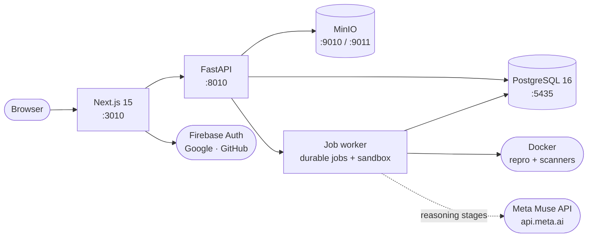

<div align="center">


# Meridian AI

[](https://github.com/VivekChaurasiya95/Meridian-AI/actions)
[](LICENSE)
[](IMPLEMENTATION_PLAN.md)
[](apps/web/package.json)
[](services/api/pyproject.toml)
[](https://github.com/VivekChaurasiya95/Meridian-AI/pulls)


**An AI-assisted debugging and reliability platform.** Meridian turns a developer's
bug report into a structured, evidence-backed investigation — reproduce, capture
evidence, hypothesize, test, patch, verify, report — with a human approving every step.

[Quickstart](#2-getting-started) · [Run the app](#3-run-the-application) ·
[API Reference](#10-api-reference) · [Roadmap](#14-roadmap) · [Author](#16-author)

</div>

---

## Contents

- [1. Overview](#1-overview)
- [2. Getting Started](#2-getting-started)
- [3. Run the Application](#3-run-the-application)
- [4. Features](#4-features)
- [5. Product Tour & Demo](#5-product-tour--demo)
- [6. Architecture](#6-architecture)
- [7. Tech Stack](#7-tech-stack)
- [8. Repository Layout](#8-repository-layout)
- [9. Documentation Index](#9-documentation-index)
- [10. API Reference](#10-api-reference)
- [11. Configuration](#11-configuration)
- [12. Testing & Quality Gates](#12-testing--quality-gates)
- [13. Security](#13-security)
- [14. Roadmap](#14-roadmap)
- [15. Troubleshooting & FAQ](#15-troubleshooting--faq)
- [16. Author](#16-author)
- [License](#license)

---

## 1. Overview

Debugging production issues usually means scattered logs, unreproducible bugs, and
fixes nobody can explain. Meridian structures that work into a repeatable pipeline:

1. **Onboard** — upload a repository ZIP; Meridian validates, inspects, and snapshots it.
2. **Reproduce** — capture the failure in an isolated sandbox with recorded evidence.
3. **Hypothesize** — generate evidence-grounded hypotheses (model-assisted, human-approved).
4. **Test & patch** — add regression tests, propose unified-diff patches behind scoped approval.
5. **Verify & report** — run baseline/post-patch verification and produce an investigation report.

Every stage is persisted, auditable, and gated by human approval where it matters.
The UI never presents unbuilt stages as real — anything not yet implemented is
explicitly marked or absent.

> **Spec authority:** `SECURITY.md` > PRD > `ARCHITECTURE.md`/`API.md` >
> `DATABASE.md` > `DESIGN_SYSTEM.md` > `IMPLEMENTATION_PLAN.md`. The files in
> `public/` are the product source of truth and are never edited in place;
> conflicts and resolutions live in [docs/DECISIONS.md](docs/DECISIONS.md).

## 2. Getting Started

### 2.1 Prerequisites

| Tool | Version | Check | Notes |
|---|---|---|---|
| Node.js + npm | ≥ 20.9 | `node --version` | Frontend, Playwright |
| Python + pip | ≥ 3.12 | `python --version` | API, worker, tests |
| Docker Desktop | current, **Linux containers** | `docker info` | Postgres, MinIO, sandbox/scanner containers |
| Git | any recent | `git --version` | To clone the repo |

Ports `3010`, `8010`, `5435`, `9010`, `9011` must be free (see
[Troubleshooting](#15-troubleshooting--faq) if one is taken).

### 2.2 One-time setup

One terminal, from the repo root:

```powershell
cd D:\Projects\Meridian-AI   # or wherever you cloned it

# 1. Environment files (never commit the real ones)
Copy-Item .env.example .env
# -> open .env and confirm DATABASE_URL / TEST_DATABASE_URL point at localhost:5435

# 2. Python environment + API package (editable install with dev extras)
python -m venv .venv
.\.venv\Scripts\Activate.ps1
pip install -e "services/api[dev]"

# 3. Infrastructure: PostgreSQL + MinIO (minio-init provisions buckets/policies)
docker compose up -d db minio minio-init

# 4. Test database (first time only), then migrations
docker exec meridian-db-1 psql -U meridian -d meridian -c "CREATE DATABASE meridian_test;"
alembic upgrade head

# 5. Frontend dependencies
cd apps/web
npm install
cd ../..
```

### 2.3 First-run checklist

After setup, confirm each layer before opening the UI:

- [ ] `docker compose ps` shows `db` and `minio` healthy
- [ ] `http://127.0.0.1:8010/health/live` returns `{"status":"ok"}` (API running)
- [ ] `http://localhost:3010` renders the landing page (web running)
- [ ] Sign up at `/signup`, create a workspace + project, upload a ZIP, and watch
      ingestion → snapshot → security preflight run end to end

## 3. Run the Application

### 3.1 Development mode (recommended)

Use one terminal per process, all from the repo root. **Start order matters:**
infrastructure → API → worker → web. Stop everything with `Ctrl+C` in each terminal.

| # | Terminal | Command | Serves |
|---|---|---|---|
| 1 | Infrastructure | `docker compose up db minio` | Postgres :5435, MinIO :9010/:9011 |
| 2 | Backend API | `uvicorn app.main:app --app-dir services/api --host 127.0.0.1 --port 8010` (venv active) | API :8010 |
| 3 | Job worker | `python services/worker/main.py` (venv active, Docker running) | Jobs, investigations, scans |
| 4 | Frontend | `cd apps/web` → `npm run dev` | Web :3010 |

```powershell
# Terminal 1 — infrastructure (leave running)
docker compose up db minio

# Terminal 2 — backend API (leave running)
.\.venv\Scripts\Activate.ps1
uvicorn app.main:app --app-dir services/api --host 127.0.0.1 --port 8010

# Terminal 3 — job worker (leave running; needs the Docker daemon for sandbox jobs)
.\.venv\Scripts\Activate.ps1
$env:WORKER_ID = "local-worker-1"   # optional; defaults to hostname-pid
python services/worker/main.py

# Terminal 4 — frontend (leave running; predev guard cleans stale caches)
cd apps/web
npm run dev
```

### 3.2 Docker Compose mode (alternative)

`docker compose up --build` runs Postgres + MinIO + API + worker together from
images; the web frontend still runs locally via `npm run dev`. Useful for
verifying the containerized API/worker path.

> Host-run API/worker talk to MinIO at `http://localhost:9010` (the compose host
> mapping). If you copied an older `.env`, make sure `S3_ENDPOINT_URL` uses port
> `9010`, not `9000`.

### 3.3 Service endpoints

| Service | URL | Notes |
|---|---|---|
| Web app | `http://localhost:3010` | Landing page |
| Workspace home | `http://localhost:3010/app` | Live API data |
| Developer page | `http://localhost:3010/developer` | Developer story |
| API liveness | `http://127.0.0.1:8010/health/live` | `{"status":"ok"}`, no DB touch |
| API readiness | `http://127.0.0.1:8010/health/ready` | DB + dependency checks |
| API interactive docs | `http://127.0.0.1:8010/docs` | FastAPI/Swagger (dev default) |
| MinIO console | `http://localhost:9011` | Buckets browser (dev credentials from compose) |
| MinIO S3 API | `http://localhost:9010` | What the API/worker use |

Readiness reports `"model": "ok"` once a model key is configured, or
`"not_configured"` until then — readiness never fails just for a missing key.

### 3.4 Daily commands

```powershell
docker compose up db minio        # start infra (foreground logs)
docker compose ps                 # service health at a glance
docker compose logs -f api        # follow a service's logs (compose mode)
docker compose stop               # stop infra, keep data
```

### 3.5 Script reference

Frontend scripts (`apps/web`, via `npm run <script>`):

| Script | Command | Purpose |
|---|---|---|
| `dev` | `next dev --port 3010` | Dev server (+ `predev` stale-cache guard) |
| `build` / `start` | `next build` / `next start` | Production build / serve |
| `clean` | stale-cache guard `--force` | Remove `.next` safely (server stopped) |
| `lint` / `typecheck` | `eslint .` / `tsc --noEmit` | CI gates |
| `e2e` | `playwright test` | Playwright suite (Chromium) |

Backend commands (repo root or `services/api`, venv active):

| Command | Purpose |
|---|---|
| `uvicorn app.main:app --app-dir services/api --host 127.0.0.1 --port 8010` | Run the API |
| `python services/worker/main.py` | Run the job worker |
| `ruff check .` / `mypy app` | Lint / typecheck (CI gates) |
| `pytest` | Full backend suite (~603 tests, `meridian_test` only) |
| `alembic upgrade head` | Apply pending migrations |

## 4. Features

| Area | What works today |
|---|---|
| 🖥️ **App shell** | Brand system, warm light/dark themes, landing page with motion design |
| 🔑 **Session auth** | Email/password signup, login, logout, `/me` profile — opaque server-side sessions |
| 🌐 **Social login** | Google and GitHub sign-in via Firebase, exchanged for the same session cookie |
| 🏢 **Workspaces** | Create/rename workspaces, cursor pagination, role-based membership (owner/admin/developer/viewer) |
| 📦 **Projects** | ZIP upload with archive validation, stack inspection, immutable snapshots, repo browser, settings |
| 🔬 **Investigations** | Staged debugging pipeline: reproduce → evidence → hypotheses → tests → patch → verify |
| 🧪 **Hypotheses & tests** | Evidence-grounded hypotheses, regression tests, baseline/post-patch verification |
| 🩹 **Patches** | Unified-diff proposals behind scoped human approval, applied only after approval |
| 📝 **Reports** | Model-written investigation summary at verification time, served per investigation |
| 🛡️ **Security preflight** | Every snapshot scanned by Semgrep + Gitleaks in isolated containers; findings API |
| 🤖 **Meta Muse** | Investigations and reports run on Muse Spark via the provider gateway |
| 🎥 **Product tour** | Animated explainer of the investigation loop, or attach your own demo video |
| 🔬 **Playground** | Interactive desktop scene: feed a file, pick a workflow, watch the agents work |
| 👨‍💻 **Developer page** | Meet-the-developer story, stack, and project highlights |
| ❤️ **Health checks** | Liveness (no DB) and readiness (DB + dependency checks) endpoints |

## 5. Product Tour & Demo

The landing page ships a **13-second motion explainer** — report → reproduce →
evidence → patch → verify — with play/pause, replay, and per-scene progress.
Prefer your own footage? Set one variable and the section swaps in your video:

```powershell
# apps/web/.env.local — YouTube link or direct .mp4 URL
NEXT_PUBLIC_DEMO_VIDEO_URL=https://www.youtube.com/watch?v=YOUR_VIDEO_ID
```

Restart the web server after changing it.

## 6. Architecture



| Service | Tech | Port | Purpose |
|---|---|---|---|
| `web` | Next.js (App Router, TypeScript, Tailwind v4) | 3010 | Landing, auth pages, workspace UI |
| `api` | FastAPI + SQLAlchemy + Alembic | 8010 | REST API, sessions, workspaces, investigations |
| `db` | PostgreSQL 16 | 5435 | Users, sessions, projects, jobs, investigations |
| `minio` | MinIO (S3-compatible) | 9010 / 9011 | Snapshot + evidence object storage, console |
| `worker` | Python job worker | — | Durable jobs, investigation pipeline, sandbox scans |
| `muse` | Meta Model API (external) | — | Reasoning stages + reports (Muse Spark, optional) |

**Request lifecycle (happy path):** browser → Next.js → FastAPI (session cookie) →
Postgres for state, MinIO for snapshot/evidence bytes; long-running work
(reproduction, scans, model reasoning) runs as durable worker jobs with leases, so
API restarts never lose or double-run a job. Untrusted repository code only ever
executes inside locked-down sandbox containers (no network, non-root, read-only
root filesystem) — never in the API process. Details: `ARCHITECTURE.md`, `SECURITY.md`.

## 7. Tech Stack

<p>
  
  
  
  
  
  
  
  
  
  
</p>

| Layer | Technology | Version constraint | Declared in |
|---|---|---|---|
| Web framework | Next.js (App Router) | `^15.1` | `apps/web/package.json` |
| UI | React + TypeScript | `^19.0` / `^5.7` | `apps/web/package.json` |
| Styling | Tailwind CSS v4 (+ PostCSS) | `^4.0` | `apps/web/package.json` |
| Motion | Framer Motion | `^12.0` | `apps/web/package.json` |
| Social auth (client) | Firebase JS SDK | `^13.1` | `apps/web/package.json` |
| API framework | FastAPI + Uvicorn | `≥0.115` / `≥0.30` | `services/api/pyproject.toml` |
| ORM / migrations | SQLAlchemy 2 + Alembic | `≥2.0,<2.1` / `≥1.13` | `services/api/pyproject.toml` |
| Database | PostgreSQL (+ psycopg 3) | 16 / `≥3.1` | `docker-compose.yml` / pyproject |
| Object storage | MinIO via boto3 | `≥1.34` | `services/api/pyproject.toml` |
| Sandbox runtime | Docker SDK for Python | `≥7` | `services/api/pyproject.toml` |
| Scanners (pinned) | Semgrep / Gitleaks images | `1.183.0` / `v8.30.1` | worker sandbox config |
| Backend QA | pytest / Ruff / mypy | `≥8.0` / `≥0.8` / `≥1.13` | `services/api/pyproject.toml` |
| E2E | Playwright (Chromium) | `^1.49` | `apps/web/package.json` |

## 8. Repository Layout

```text
apps/web/                 Next.js frontend (App Router, TypeScript, Tailwind v4)
├── app/                  Routes: landing (/), login, signup, /app, /developer, playground
├── components/           auth · brand · landing · shell · ui · workspaces
├── e2e/                  Playwright specs (4 files, 9 cases)
├── lib/                  API client, Firebase helpers, theme utilities
├── scripts/              Dev guards (stale-.next cleanup)
└── public/               Brand art + developer portrait
services/api/             FastAPI backend — app/ source with co-located tests/
services/worker/          Durable job worker: pipeline, sandbox, security preflight
migrations/               Alembic migrations, versioned history (head: 015)
docs/DECISIONS.md         Working architecture decision log (D1–D69+)
public/                   Product specifications — source of truth; never edited
docker-compose.yml        db · minio · minio-init · api · worker services
.env.example              Template for ALL root variables the app reads
```

## 9. Documentation Index

| Document | What it covers |
|---|---|
| `PRD.md` (in `public/`) | Product requirements, scope, acceptance criteria |
| `ARCHITECTURE.md` | System design, service boundaries, data flow |
| `API.md` | Full REST reference beyond the summary in §10 |
| `DATABASE.md` | Schema, relationships, migration policy |
| `DESIGN_SYSTEM.md` | Brand tokens, components, motion language |
| `IMPLEMENTATION_PLAN.md` | Milestone plan M1–M10, current status |
| `SECURITY.md` | Threat model, controls, credential policy |
| `docs/DECISIONS.md` | Decision log — read before changing architecture |

## 10. API Reference

Base path `/api/v1`. All responses use the `{data, request_id}` /
`{error, request_id}` envelope. Sessions travel in the `meridian_session`
HttpOnly cookie (`SameSite=Lax`) or as `Bearer` tokens (see `docs/DECISIONS.md`
D17–D20). Interactive docs: `/docs` while the API runs locally.

<details>
<summary><strong>Endpoints (M2 core)</strong></summary>

| Method & path | Purpose | Auth |
|---|---|---|
| `GET /health/live` | `{"status":"ok"}` — no DB touch | — |
| `GET /health/ready` | `{"status":"ready","checks":{…}}` or `503` | — |
| `POST /api/v1/auth/signup` | `{email, password, display_name}` → `201` + session cookie | — |
| `POST /api/v1/auth/login` | `{email, password}` → `200` + session cookie | — |
| `POST /api/v1/auth/firebase` | `{id_token}` (Google/GitHub) → `200` + session cookie; `503` if unconfigured | — |
| `POST /api/v1/auth/logout` | `204`, revokes session, clears cookies | Session |
| `GET /api/v1/me` | Current profile | Session |
| `PATCH /api/v1/me` | `{display_name}` — allowlisted field only | Session |
| `POST /api/v1/workspaces` | `{name, slug}` → `201` | Session |
| `GET /api/v1/workspaces?limit&cursor` | Paginated workspace list | Session |
| `GET /api/v1/workspaces/{id}` | Workspace + caller's role | Member |
| `PATCH /api/v1/workspaces/{id}` | `{name}` | Owner/admin |
| `GET /api/v1/workspaces/{id}/members` | Member list | Member |
| `POST /api/v1/workspaces/{id}/members` | Add existing user `{email, role}` | Owner/admin |
| `PATCH /api/v1/workspaces/{id}/members/{user_id}` | Change role (never demote last owner) | Owner/admin |
| `DELETE /api/v1/workspaces/{id}/members/{user_id}` | Remove member (never the last owner) | Owner/admin |

</details>

Beyond M2 the API covers projects, snapshots, repo browser, jobs, executions,
investigations, hypotheses, evidence, regression tests, patches, verification,
reports, and security assessments — see `API.md` for the full reference.

## 11. Configuration

Copy `.env.example` → `.env` (root, for the API/worker) and create
`apps/web/.env.local` (for the browser — Next.js does not read the root file).
Never commit either. Secrets rules: no secrets in chat/logs, none in committed
files, model key stays server-side only (never `NEXT_PUBLIC_`).

### 11.1 Core (root `.env`)

| Variable | Default | Purpose |
|---|---|---|
| `DATABASE_URL` | `…@localhost:5435/meridian` | API/worker database |
| `TEST_DATABASE_URL` | `…/meridian_test` | Pytest database — never point at dev |
| `CORS_ALLOW_ORIGINS` | loopback origins | Allowed browser origins |
| `SECURE_COOKIES` | `false` | Set `true` in production (HTTPS) |
| `WORKER_ID` | hostname-pid | Worker identity in logs/leases |

### 11.2 Storage (root `.env`)

| Variable | Default | Purpose |
|---|---|---|
| `S3_ENDPOINT_URL` | `http://localhost:9010` | MinIO S3 API (compose host mapping) |
| `S3_ACCESS_KEY` / `S3_SECRET_KEY` | dev defaults | MinIO identity (least privilege per service) |

### 11.3 Model providers — Meta Spark + Meta SAM (root `.env`, optional)

All LLM calls go through the centralized gateway (`services/api/app/ai/`) with
task-based routing, token budgets, secret redaction, and metadata-only telemetry.
Deterministic scanners (Semgrep/Gitleaks) remain the source of findings. Models
never invent scan results and never execute code outside the sandbox.

Meta Spark (text/reasoning) powers investigation planning, root-cause analysis,
report generation, and summarization. Meta SAM (image segmentation) powers
screenshot/evidence analysis in the worker only. Both ship disabled. Verify the
exact base URL and model IDs in the provider documentation before enabling.

```dotenv
META_ENABLED=false
META_BASE_URL=
META_API_KEY=
META_MODEL_DEFAULT=
META_MODEL_REASONING=
META_MODEL_FAST=
META_MODEL_REPORT=
META_SPARK_ENABLED=false
META_SPARK_BASE_URL=
META_SPARK_API_KEY=
META_SPARK_MODEL=
META_SAM_ENABLED=false
META_SAM_BASE_URL=
META_SAM_API_KEY=
META_SAM_MODEL=
```

Copy the Meta block from `.env.example` into your local `.env`. Never commit
`.env`. The app keeps working without keys. Restart the API and worker after
changing values. See `META_INTEGRATION_PLAN.md` for routing and safeguards.

### 11.4 Social sign-in — Firebase (optional)

Password auth works with zero setup. To enable the Google/GitHub buttons:

1. In the [Firebase console](https://console.firebase.google.com), create a project
   (or reuse one), then **Authentication → Sign-in method**: enable **Google** and
   **GitHub**. For GitHub, create a GitHub OAuth App (GitHub Settings → Developer
   settings) with authorization callback URL
   `https://<your-project-id>.firebaseapp.com/__/auth/handler`, and paste its
   client ID/secret into Firebase.
2. **Authentication → Settings → Authorized domains**: add `localhost`.
3. **Project settings → Your apps → Web**: register a web app and copy its config.
4. Put the web config in `apps/web/.env.local` (`NEXT_PUBLIC_FIREBASE_*`) and set
   `FIREBASE_PROJECT_ID` in the repo-root `.env`. Restart both servers. The API
   needs only the project ID — tokens verify against Google's public certs, so no
   service-account key is stored anywhere.

### 11.5 Frontend (`apps/web/.env.local`)

| Variable | Default | Purpose |
|---|---|---|
| `NEXT_PUBLIC_API_URL` | `http://localhost:8010` | API base for the browser |
| `NEXT_PUBLIC_FIREBASE_*` | empty (disabled) | Firebase web config (4 keys) |
| `NEXT_PUBLIC_DEMO_VIDEO_URL` | empty (placeholder) | Landing demo video |

## 12. Testing & Quality Gates

Every push runs three CI jobs ([workflow](.github/workflows/ci.yml)):

| Job | Gates |
|---|---|
| `api` | `ruff check`, `mypy`, `alembic upgrade head`, `pytest` |
| `web` | `npm run lint`, `npm run typecheck`, `npm run build` |
| `e2e` | Playwright, Chromium — no backend required |

Run the same gates locally:

```powershell
# Backend (services/api; needs TEST_DATABASE_URL up on :5435)
ruff check .
mypy app
pytest                                   # full suite, ~603 tests

# Frontend (apps/web)
npm run lint
npm run typecheck
npm run build
npx playwright install --with-deps chromium   # first time only
npm run e2e
```

Current coverage: **603 backend tests** (auth through investigations, hypotheses,
regression tests, patches, verification, reports, security preflight) and **9 e2e
cases** (landing, auth forms, password toggles, theme, API-base units).

**Test-database safety:** the suite connects via `TEST_DATABASE_URL` only (default
`…/meridian_test`). Never point it at `meridian` — suite setup/teardown truncates
test tables.

## 13. Security

Meridian executes untrusted repository code by design, so isolation is a
first-class feature, not an afterthought. Key controls (see `SECURITY.md` for the
full threat model):

- Untrusted code runs only in locked-down sandbox containers: no network, non-root
  user, read-only root filesystem, dropped capabilities, CPU/memory/PID/output limits.
- The FastAPI process never executes repository code; only the worker talks to Docker,
  and execution containers never receive the Docker socket or app credentials.
- Repository-supplied Dockerfiles, install scripts, and lifecycle hooks are never
  executed; image builds use trusted, application-controlled instructions only.
- MinIO identities follow least privilege per service (admin / API / worker-scoped).
- Sessions are opaque, server-side, and transported in HttpOnly `SameSite=Lax` cookies.
- Security preflight (Semgrep + Gitleaks, pinned images) scans every snapshot in
  isolation; raw scanner output is never persisted.

Found a vulnerability? Please report it privately to the author (see §16) rather
than opening a public issue.

## 14. Roadmap

Full plan: `IMPLEMENTATION_PLAN.md`.

- [x] **M1** — App shell, brand system, landing page
- [x] **M2** — Session auth (password + Firebase social), workspaces, membership roles
- [x] **M3** — Project onboarding (ZIP validation, inspection, snapshots); MinIO reserved for M3+ evidence
- [x] **M4** — Durable jobs + leases/recovery + worker (ruff/mypy/pytest + lint/typecheck/build green)
- [x] **M5** — Isolated execution worker (sandbox smoke profile + execution observability; project-specific profiles future)
- [x] **M6** — Investigations, browser reproduction (static profile), evidence + audit
- [x] **M7** — Evidence-grounded hypotheses via a provider adapter (fake default blocks honestly)
- [x] **M8** — Regression tests, baseline/post-patch verification, patch proposals with scoped human approval
- [x] **M9** — Investigation reports, security preflight (Semgrep + Gitleaks), Meta Muse wiring
- [x] **M10** — Verification reruns/comparison (API + investigation detail UI)

## 15. Troubleshooting & FAQ

**Port already in use (`EADDRINUSE` / WinError 10048 on 8010 or 3010).**
A previous server is still holding the port. Identify it, then stop only your own
process — never kill processes you don't recognize:

```powershell
Get-NetTCPConnection -LocalPort 8010 -State Listen | ForEach-Object {
  Get-CimInstance Win32_Process -Filter ("ProcessId = " + $_.OwningProcess) |
    Select-Object ProcessId, ExecutablePath, CommandLine
}
```

`TimeWait` rows without a `Listen` row mean the port is free (closing remnants).

**Chunk 404s (`/_next/static/… 404`) after a build.**
A production `.next` is shadowing the dev server. Stop dev (`Ctrl+C`), then:

```powershell
cd apps/web
npm run clean
npm run dev
```

…and hard-refresh (`Ctrl+Shift+R`). Always start dev via `npm run dev` (its
`predev` guard removes production caches); never run `next build` under a live dev
server.

**Webpack `ENOENT … .pack.gz` + forced full reloads.**
`.next` was deleted while the dev server was running, leaving its in-memory cache
index dangling. Same fix: stop the server first, `npm run clean`, start once.

**API can't reach Postgres (`connection refused` on :5435).**
`docker compose up db` must be running first; confirm `DATABASE_URL` uses host port
`5435` (the container-internal `5432` only works between containers).

**Tests hitting the wrong database.**
The suite uses `TEST_DATABASE_URL` exclusively (default `…/meridian_test`, safe).
Never point it at `meridian`. Suite setup/teardown truncates test tables only.

**Sandbox jobs fail immediately.**
The worker needs the Docker daemon (Desktop, Linux containers) plus the pinned
images: `python:3.12-slim`, `semgrep/semgrep:1.183.0`,
`zricethezav/gitleaks:v8.30.1` (`docker pull …` each once).

**How do I see service logs?** `docker compose logs -f <service>` (e.g. `db`,
`minio`, `api` in compose mode). Host-run API/worker log to their own terminals.

## 16. Author

<div align="center">

**Vivek Chaurasiya && Arin Gupta** — Full-stack developer · Creator of Meridian AI

[](https://github.com/VivekChaurasiya95)
[](https://www.linkedin.com/in/vivek-chaurasiya-722037315)
[](https://vivek-chaurasiya.vercel.app)

*Designed & built end to end — interface, API, data model, and infrastructure.*

</div>

## License

MIT — see [LICENSE](LICENSE).
